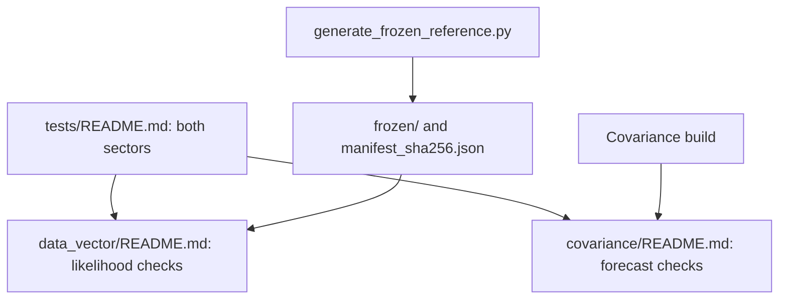
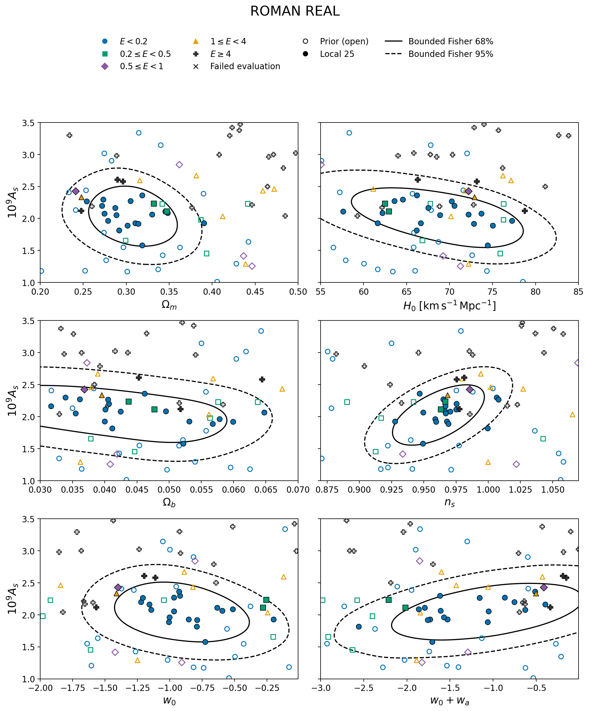

# Tests

The Roman real tests and optional studies are organized as follows.

- [Data-vector and likelihood checks](data_vector/README.md) cover the project
  predictions, frozen inputs and numerical diagnostics.
- [Covariance checks](covariance/README.md) cover forecast assembly and its
  documented component checks. Covariance generation must be compiled.
- <a name="optional_studies"></a>[Optional studies](studies/README.md#optional_studies)
  compare n(z) reconstructions and numerical accuracy, with plots and
  $\Delta\chi^2$ results. Run them separately from the routine tests.

Read this page, then the guide of each sector. The stored snapshot under
`frozen/` feeds the data-vector checks; the covariance checks need the
covariance build:



The data-vector sector includes the setting-sequence tests
(`data_vector/test_setting_sequences.py`): they change cosmolike
settings in one process, as a notebook does between evaluations, and
compare every result bit for bit with a separate process that saw only
the final settings. A change the loaded data layout cannot follow must
stop with a clear message instead of returning numbers computed from
the earlier settings. The sequences here include the galaxy-galaxy
lensing exclusion list replaced in one process, with and without the
explicit pair recount.

We assume Cocoa and this project are installed, the Cocoa Conda environment
is active, the shell is Bash, and the current folder is `cocoa/Cocoa/`.

Run the sectors in separate Python invocations: they initialize different
compiled-library state. Running one project at a time also avoids importing
another project's same-named test helpers.

**Step :one:**: activate Cocoa.

```bash
source start_cocoa.sh
```

**Step :two:**: run the data-vector sector.

```bash
python -m pytest ./projects/roman_real/tests/data_vector
```

**Step :three:**: enable covariance generation.

```bash
unset IGNORE_COSMOLIKE_ROMAN_REAL_COVARIANCE
```

**Step :four:**: compile the project.

```bash
source ./projects/roman_real/scripts/compile_roman_real.sh
```

**Step :five:**: run the covariance sector.

```bash
python -m pytest ./projects/roman_real/tests/covariance
```

The project must be enabled in `set_installation_options.sh` before
activation. A covariance skip in a deliberately disabled build is expected;
it is not a successful covariance check. Read the sector guide to distinguish
asserted regressions from advisory accuracy reports.

Frozen configurations and inputs are protected by `manifest_sha256.json`.
Do not regenerate references to silence an unexplained failure. The sector
guides document the deliberate reference-update procedure and its limits.

Hybrid examples can be checked without sampling:

**Step :one:**: check configuration 1.

```bash
python ./projects/roman_real/EXAMPLE_EMUL2_MINIMIZE1.py --check
```

**Step :two:**: check configuration 2.

```bash
python ./projects/roman_real/EXAMPLE_EMUL2_MINIMIZE2.py --check
```


## Matter-spectrum emulator comparison

[compare_emulator_camb.py](compare_emulator_camb.py) compares the candidate
matter-spectrum emulator with fresh CAMB predictions at the saved 50
broad and 25 focused cosmologies. Its fixed [benchmark](fisher_reference/)
supplies the nuisance point, mask and covariance, enforces $0.2<\Omega_m<0.5$,
and fixes
$\sum m_\nu=0.06$ eV. Both routes use plain `mead2020` and CAMB distances;
the production YAML is not changed. The selected example has HOD galaxy
power and halo intrinsic alignments disabled. Its prediction therefore does
not test the EMUL2 approximation to cold-matter power used by those models.
The two routes retain their own power-spectrum coverage and extrapolation,
so the distance includes those differences as well as network error.

**Step :one:**: from activated Cocoa, set `EMULATOR_CODE_DIR` and
`EMULATOR_DATA_DIR` to the candidate code and model checkouts. The model checkout must contain
`emulmps/w0wa_mead2020/emulator_mead2020.keras` and its `metadata.joblib`.
**Step :two:**: set the OpenMP thread count. The driver fixes BLAS to one
thread before importing numerical libraries.

```bash
export OMP_NUM_THREADS=4
```

**Step :three:**: run the comparison.

```bash
python projects/roman_real/tests/compare_emulator_camb.py
```

The script uses the existing shared `cocoa_testing.py` machinery. It saves
points, vectors, failures and the prediction distance
$\Delta\chi^2=\delta m^T C^{-1}\delta m$ under
a timestamped directory below `chains/matter_emulator_points/`. A value below 1 passes the
requested criterion; failures are retained, never replaced by new draws.
The project prior can extend beyond the emulator training range. Separate
those extrapolation failures from interpolation errors when interpreting
the saved points; this test does not narrow the prior to favor the emulator.
`--models`, `--seed` and `--limit` change the test size, reproducible seed and
threshold. BLAS stays at one thread. This comparison does not establish
that posterior importance weights have adequate effective sample size;
that must be checked on the chain used for reweighting.

### Official hybrid-emulator accuracy test

<!-- hybrid-emulator figure -->
The test uses the numbered example's priors and fixes $m_\nu=0.06$ eV. It draws cosmologies with $w_0>-2$, $1<10^9 A_s\leq 3.5$, $H_0<85$ km/s/Mpc, $0.2<\Omega_m<0.5$, and $\Omega_b(H_0/100)^2<0.035$.
The open symbols show 50 broad draws. The filled symbols show 25 focused draws from the Fisher distribution under the same cuts.
The solid and dashed curves enclose the 68% and 95% regions of the nuisance-marginalized Fisher forecast.
The official test evaluates CAMB and the emulator on the same [fixed parameter tables](frozen/emulator_precision/) each time.



Copy a completed run's `fisher/emulator_fisher.png` to `tests/figures/emulator_precision.png` to refresh this figure.
<!-- end hybrid-emulator figure -->

E5 reads the saved `benchmark.yaml` in [fisher_reference/](fisher_reference/).
The benchmark fixes the likelihood, data selection, sampled parameters,
fiducial and normal numerical controls. The figures above record earlier
runs with the CAMB mean controls used at that time.

The accuracy test evaluates CAMB and the candidate at the fixed
[50 broad and 25 focused points](fisher_reference/) and stores both
vectors, the covariance-weighted error, and point status. Nuisance inputs are
held at the evaluate fiducial. Missing CAMB predictions or a comparison
with no valid vectors fails E5. The E5 adapter treats large prediction errors
as advisory. The strict standalone command also checks the error threshold.

```bash
python -m pytest projects/roman_real/tests/data_vector/test_emul2.py -k e5
```

To distribute the numerical comparisons across two MPI ranks with four
OpenMP threads each, use the same driver directly from activated Cocoa.
Keep BLAS at one thread and pass `--mpi` so the ranks own different points.

```bash
OMP_NUM_THREADS=4 OPENBLAS_NUM_THREADS=1 MKL_NUM_THREADS=1 \
  VECLIB_MAXIMUM_THREADS=1 mpirun -n 2 --bind-to none python -m mpi4py \
  projects/roman_real/tests/compare_emulator_camb.py --mpi --advisory
```

Saved Fisher contours show the bounded 68% and 95% regions of a centered
CAMB forecast with nuisance parameters marginalized. The saved reference
records the matrix, priors, fiducial, selection and numerical diagnostics.
The accuracy run uses the available saved contour for display. Prediction
errors remain valid when the saved contour is absent or marked unreliable. `--fisher-reference` selects a saved directory, and
`--no-fisher` omits the display. Candidate networks can be changed using
`EMULATOR_CODE_DIR` and `EMULATOR_DATA_DIR`.

```bash
python projects/roman_real/tests/compare_emulator_camb.py --plot-only /path/to/run
```

### Separate FoM screen

```bash
OMP_NUM_THREADS=4 OPENBLAS_NUM_THREADS=1 MKL_NUM_THREADS=1 \
  VECLIB_MAXIMUM_THREADS=1 mpirun -n 2 --bind-to none python -m mpi4py \
  projects/roman_real/tests/check_fom_convergence.py --mpi
```

The FoM screen builds the full CAMB baseline once. Each nonzero coordinate
uses `h = 0.025 * abs(fiducial)`, capped when needed to keep both
`±2h` stencil points within the prior. Zero-centered coordinates use
their configured absolute step, or one tenth of their proposal width.
The archive records every actual step. Fourth differences at that one
spacing rank the numerical noise contributions. Only the selected
columns run at higher accuracy; the output records the omitted columns
and the estimated FoM shift. This command is independent of E5.

Use `--save-fisher-contours` to explicitly integrate and store a bounded
contour for later accuracy plots. The calculation writes the reference to
`reference/` under its output directory. `--validate-fisher-steps` opts
into the more expensive full comparison at two stencil spacings and multiple
accuracy settings.
