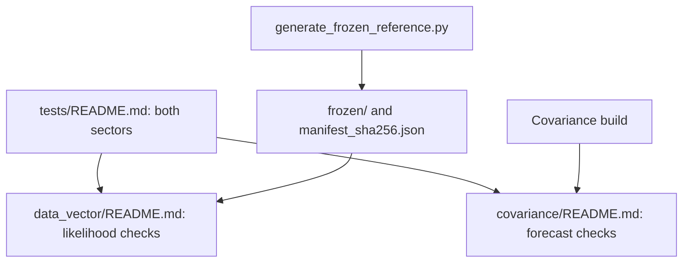

# Tests

The Roman real tests and optional studies are organized as follows.

- [Data-vector and likelihood checks](data_vector/README.md) cover the project
  predictions, frozen inputs and numerical diagnostics.
- [Covariance checks](covariance/README.md) cover forecast assembly and its
  documented component checks. Covariance generation must be compiled.
- <a name="optional_studies"></a>[Optional studies](studies/README.md#optional_studies)
  compare n(z) reconstructions and numerical accuracy, with plots and
  $\Delta\chi^2$ results. Run them separately from the routine tests.

Read this page, then the guide of each sector. The stored snapshot under
`frozen/` feeds the data-vector checks; the covariance checks need the
covariance build:



The data-vector sector includes the setting-sequence tests
(`data_vector/test_setting_sequences.py`): they change cosmolike
settings in one process, as a notebook does between evaluations, and
compare every result bit for bit with a separate process that saw only
the final settings. A change the loaded data layout cannot follow must
stop with a clear message instead of returning numbers computed from
the earlier settings. The sequences here include the galaxy-galaxy
lensing exclusion list replaced in one process, with and without the
explicit pair recount.

We assume Cocoa and this project are installed, the Cocoa Conda environment
is active, the shell is Bash, and the current folder is `cocoa/Cocoa/`.

Run the sectors in separate Python invocations: they initialize different
compiled-library state. Running one project at a time also avoids importing
another project's same-named test helpers.

**Step :one:**: activate Cocoa.

```bash
source start_cocoa.sh
```

**Step :two:**: run the data-vector sector.

```bash
python -m pytest ./projects/roman_real/tests/data_vector
```

**Step :three:**: enable covariance generation.

```bash
unset IGNORE_COSMOLIKE_ROMAN_REAL_COVARIANCE
```

**Step :four:**: compile the project.

```bash
source ./projects/roman_real/scripts/compile_roman_real.sh
```

**Step :five:**: run the covariance sector.

```bash
python -m pytest ./projects/roman_real/tests/covariance
```

The project must be enabled in `set_installation_options.sh` before
activation. A covariance skip in a deliberately disabled build is expected;
it is not a successful covariance check. Read the sector guide to distinguish
asserted regressions from advisory accuracy reports.

Frozen configurations and inputs are protected by `manifest_sha256.json`.
Do not regenerate references to silence an unexplained failure. The sector
guides document the deliberate reference-update procedure and its limits.

Hybrid examples can be checked without sampling:

**Step :one:**: check configuration 1.

```bash
python ./projects/roman_real/EXAMPLE_EMUL2_MINIMIZE1.py --check
```

**Step :two:**: check configuration 2.

```bash
python ./projects/roman_real/EXAMPLE_EMUL2_MINIMIZE2.py --check
```


## Matter-spectrum emulator comparison

[compare_emulator_camb.py](compare_emulator_camb.py) compares the candidate
matter-spectrum emulator with fresh CAMB predictions at 50 reproducible
cosmologies from `EXAMPLE_EVALUATE1.yaml`. This study reads that live YAML,
not the frozen regression configuration. It retains the example's nuisance
point, mask and covariance, restricts $0.2<\Omega_m<0.5$, and fixes
$\sum m_\nu=0.06$ eV. Both routes use plain `mead2020` and CAMB distances;
the production YAML is not changed. The selected example has HOD galaxy
power and halo intrinsic alignments disabled. Its prediction therefore does
not test the EMUL2 approximation to cold-matter power used by those models.
The two routes retain their own power-spectrum coverage and extrapolation,
so the distance includes those differences as well as network error.

**Step :one:**: from activated Cocoa, set `EMULATOR_CODE_DIR` and
`EMULATOR_DATA_DIR` to the candidate code and model checkouts. The model checkout must contain
`emulmps/w0wa_mead2020/emulator_mead2020.keras` and its `metadata.joblib`.
**Step :two:**: set the OpenMP thread count. The driver fixes BLAS to one
thread before importing numerical libraries.

```bash
export OMP_NUM_THREADS=4
```

**Step :three:**: run the comparison.

```bash
python projects/roman_real/tests/compare_emulator_camb.py
```

The script uses the existing shared `cocoa_testing.py` machinery. It saves
points, vectors, failures and the prediction distance
$\Delta\chi^2=\delta m^T C^{-1}\delta m$ under
`chains/matter_emulator_prior/EXAMPLE_EVALUATE1/with_fisher/`. A value below 1 passes the
requested criterion; failures are retained, never replaced by new draws.
The project prior can extend beyond the emulator training range. Separate
those extrapolation failures from interpolation errors when interpreting
the saved points; this test does not narrow the prior to favor the emulator.
`--models`, `--seed` and `--limit` change the test size, reproducible seed and
threshold. BLAS stays at one thread. This comparison does not establish
that posterior importance weights have adequate effective sample size;
that must be checked on the chain used for reweighting.

### Official hybrid-emulator test and Fisher figure

The E5 test includes the approved accuracy figure whenever the hybrid
emulator code and networks are installed. No separate plotting flag is
needed. `EMULATOR_CODE_DIR` and `EMULATOR_DATA_DIR` can select candidate
checkouts. This is a long numerical test: it evaluates 50 prior cosmologies
through CAMB and the emulator, computes Fisher derivatives at two step
sizes, and evaluates 25 focused points drawn from the bounded Fisher
distribution. It keeps BLAS at one thread.

**Step :one:**: run the official comparison.

```bash
python -m pytest projects/roman_real/tests/data_vector/test_emul2.py -k test_e5_hybrid_emulator_fisher
```

Each invocation saves vectors, parameters, provenance, diagnostics and the
PNG/PDF figure in a new directory below `chains/hybrid_emulator_tests/`.
The colors show the direct prediction error
`E = (emulator - CAMB).T @ precision @ (emulator - CAMB)` at thresholds
0.2, 0.5, 1 and 4. Errors from 1 to 4, errors at least 4, and failed
nonfinite predictions have separate categories. Marker shape identifies
the error category; prior points are open and focused points are filled.
Failed predictions use a cross. The title identifies the project. The amplitude
axis stops at 3.5, or at a tighter project bound; this cap does not establish
accuracy throughout the box.

The default Fisher calculation uses `EXAMPLE_EVALUATE1.yaml`: its own
fiducial point, cosmic-shear data vector, mask, covariance and sampled
cosmological and source nuisance parameters. The emulator errors use this
same observable. These are project-specific forecasts, not a copy of the
DES Y6 contour. The synthetic vector was built with the example's theory
choice; matching both test routes to plain `mead2020` need not give zero
chi-squared against that stored vector.

The focused cosmological points are drawn from the bounded Fisher after
marginalizing its nuisance parameters. Both accuracy samples keep nuisance
inputs fixed at the example values. Their predictions and errors are saved
under `local/` for the focused sample; the errors are evaluated through
both theory routes, not inferred from the Fisher approximation.
An optional `--local-points` named-column table replaces the generated
focused sample and is recomputed through both theory routes.

The Fisher calculation includes Gaussian prior curvature and applies hard
bounds before marginalizing the plotted pairs. Solid/dashed contours enclose
68/95 percent of this centered local approximation; they are not measured
posterior contours. Insufficient bounded-sample convergence fails the test.
For NLA, the quadratic-alignment amplitude and slope and the density-weighting
amplitude are absent from the prediction at every parameter value. Their
independent priors integrate to constants, so these parameters are omitted
from the Fisher integral. Other zero-response directions retain their
bounds: a vanishing local derivative need not imply global independence.

Large prediction errors and individual nonfinite emulator predictions are
reported as advisory results. Missing CAMB references, no valid comparisons,
or an incomplete Fisher/plot calculation fail the test. Frozen regression
references and production theory choices are not changed.

**Step :two:**: to redraw a completed run, set `EMULATOR_COMPARISON_DIR`
to its directory:

```bash
python projects/roman_real/tests/compare_emulator_camb.py --plot-only "$EMULATOR_COMPARISON_DIR"
```

Add `--resample-fisher --fisher-sample-power 20` to repeat only the bounded
integration with more samples. `--no-fisher` is available in the standalone
driver for a prediction-only diagnostic; E5 does not use it. The driver
supports `--models`, `--seed`, `--points` and `--output` for explicit studies.
Its `--advisory` flag is used by E5; without it, accuracy exceedances also
produce a nonzero exit code.
