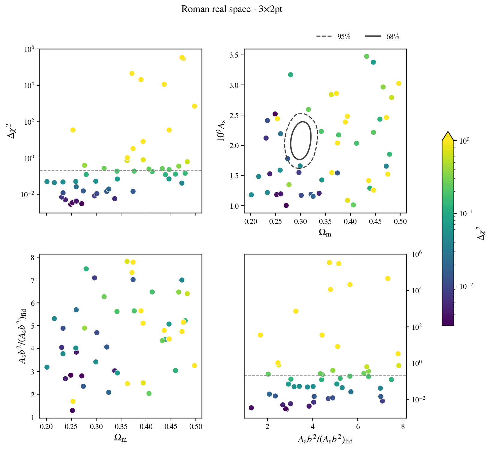
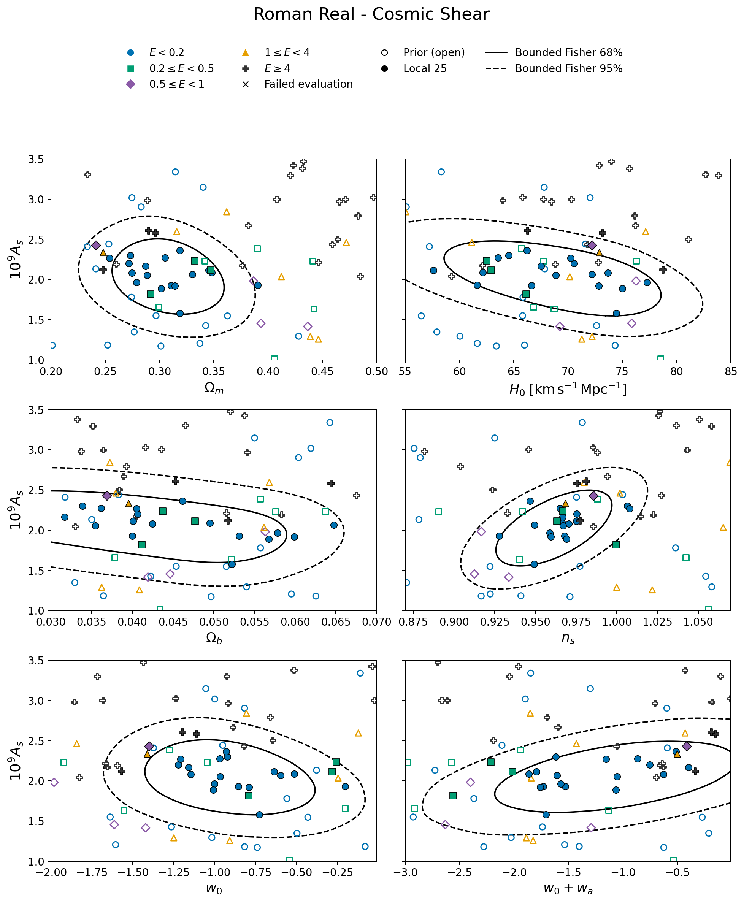
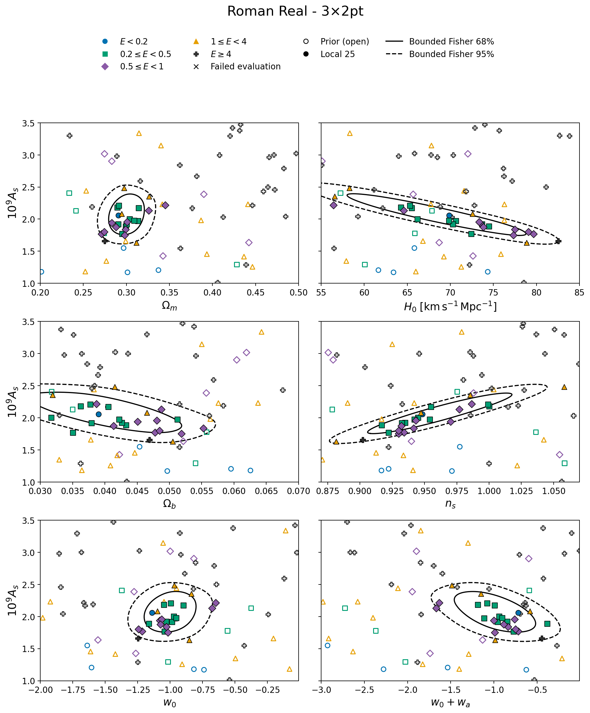

# Unit tests for the likelihoods

The frozen snapshot `frozen/` and its manifest `manifest_sha256.json`
live in the parent `tests/` directory; the paths below are relative to
it.

These tests catch two kinds of silent breakage: a $\chi^2$ that drifted
because code or data changed by accident, and a race condition (a bug
where evaluating several points in a row corrupts a later result
through leftover internal state or colliding OpenMP threads).

Fiducial checks build each model in a worker subprocess. In this project
both examples share one data set, so the isolation is preventive: it
keeps the tests immune to the process abort that different data-set
dimensions trigger inside cosmolike, and every project keeps one
architecture. The commands below stay the same.

The mechanism of every shared check family - the frozen-reference and
race contract, the zero-baseline construction, the sweeps and their
`--high`/`--mask` options, the accuracy settings and their meanings -
is documented once in
[the shared data-vector checks](https://github.com/CosmoLike/cocoa-cosmolike-core/blob/main/README.md#dv_checks)
of the CosmoLike core. This file records what roman_real runs and what
it measured.

# Table of contents

1. [Running the tests](#run_tests)
2. [The tests](#the_tests)
    1. [The CFASTPT vs FASTPT comparison](#cfastpt_fastpt)
    2. [The Halofit vs EE2 checks](#halofit_ee2)
    3. [The EE2 race test](#ee2_race)
    4. [Scale-cut diagnostics](#scale_cut_diagnostics)
    5. [Accuracy checks](#accuracy_checks)
    6. [N-random-models accuracy check](#nmodels_check)
    7. [Baryonic feedback checks](#baryon_checks)
    8. [The photo-z convention checks](#photoz_conventions)
    9. [The non-Limber checks](#nonlimber_checks)
    10. [The sector-ladder cache check](#cache_ladder)
    11. [The halo-model checks](#halo_checks)
    12. [The non-Limber early-exit tolerance checks](#nonlimber_tolerance)
    13. [The non-Limber radial grid](#nonlimber_grid)
3. [Hybrid-emulator accuracy test](#hybrid-emulator-accuracy-test)
4. [FoM convergence](#fom-convergence)
5. [Appendix](#appendix)
    1. [FAQ: What does this project's snapshot hold?](#frozen_copy)
    2. [FAQ: How can maintainers refresh the snapshot?](#refreeze)

## Running the tests <a name="run_tests"></a>

Use Bash in the main `cocoa/Cocoa/` directory with the Cocoa Conda
environment activated.

**Step :one:** Load Cocoa.

```bash
source start_cocoa.sh
```

**Step :two:** Set four OpenMP threads and one BLAS thread.

- Linux

      export OMP_NUM_THREADS=4 COCOA_TEST_OMP_THREADS=4 OMP_DYNAMIC=FALSE \
        OMP_PROC_BIND=close OMP_PLACES=cores OPENBLAS_NUM_THREADS=1 \
        OPENBLAS_DEFAULT_NUM_THREADS=1 MKL_NUM_THREADS=1 VECLIB_MAXIMUM_THREADS=1

- macOS (arm)

      export OMP_NUM_THREADS=4 COCOA_TEST_OMP_THREADS=4 OMP_DYNAMIC=FALSE \
        OMP_PROC_BIND=disabled OMP_PLACES=cores OPENBLAS_NUM_THREADS=1 \
        OPENBLAS_DEFAULT_NUM_THREADS=1 MKL_NUM_THREADS=1 VECLIB_MAXIMUM_THREADS=1

**Step :three:** Run the data-vector tests.

```bash
python -m pytest -s projects/roman_real/tests/data_vector
```

For unittest discovery, use this alternative.

```bash
python -m unittest discover -s projects/roman_real/tests/data_vector -v
```


## The tests <a name="the_tests"></a>

The standard configurations get four tests each - the frozen-reference
drift check and the race check, in NLA and in TATT
([mechanism](https://github.com/CosmoLike/cocoa-cosmolike-core/blob/main/README.md#dv_frozen)).
The TATT variants set

    IA_model: 1
    roman_A2_1: 0.05
    roman_BTA_1: 0.05
    roman_A2_2: -1.51541

The tests follow the shared
[test-file naming convention](https://github.com/CosmoLike/cocoa-cosmolike-core/blob/main/README.md#dv_naming): a file name
means the same thing in every project. This project's
configurations and test numbers:

| file | configuration | tests |
|---|---|---|
| `test_example1.py` | cosmic shear | 1-4 |
| `test_example2.py` | 3x2pt | 5-8 |
| `test_example2_2x2pt.py` | 2x2pt (`roman_real.combo_2x2pt`) | 11-14 |
| `test_notebook_interface.py` | the notebook-style direct interface (EXAMPLE_EVALUATE1.ipynb's call sequence: its own CAMB run, `set_cosmology`, `compute_data_vector_masked`, no cobaya) on the frozen cosmic-shear dataset and point | 15 |
| `test_fastpt.py` | the sweep: shear; 3x2pt (`roman_real.combo_3x2pt`); 2x2pt (`roman_real.combo_2x2pt`) | 16, 17, 18 |
| `test_ee2.py` | race | 19 |
| `test_halo_ia_race.py` | 3x2pt with Limber ggl; halo-model IA (`include_halo_IA: 1`, Fortuna et al. 2021); only with `COCOA_HALO_SLOW=1` | 20: ten same-model evaluations bitwise; 21: fresh processes at 1, 4, 8 threads bitwise |

Tests 9 and 10 are not used: the numbering follows the shared
convention, where they are the frozen FAST-PT reference checks
this project does not ship.

Test 15 exists because a changed interface binding (init_IA growing
`ia_code`) or a grid rejected by the C layer breaks every notebook
while the yaml pipeline keeps passing.

### The CFASTPT vs FASTPT comparison (`test_fastpt.py`, tests 16-18) <a name="cfastpt_fastpt"></a>

The sweep mechanism, the zero-baseline construction and the
`--high`/`--mask` options are in
[the shared checks](https://github.com/CosmoLike/cocoa-cosmolike-core/blob/main/README.md#dv_fastpt).
Here, test 16 runs it on cosmic shear, test 17 on the 3x2pt likelihood
and test 18 on the 2x2pt likelihood. In test 17 the frozen
configuration fixes the one-loop bias amplitudes (`roman_B2_*`) at
zero, so the sweep scores the intrinsic-alignment tables alone on the
wider data vector; in test 18 the TATT tables are scored through
galaxy-galaxy lensing alone.

The roman_real scale-cut masks `--mask` accepts: `frozen` (the
default) keeps the frozen contract's `example1.mask` scale cuts
(1,950 of the 2,115 data points); `ones` keeps every point.

> [!NOTE]
> Before the two-grid upgrade of the fastpt theory block (2026-09)
> there was no upsampling and the difference reached
> $\Delta\chi^2 = 2248$ across the prior.

| output table (points) | internal grid (points) | max Δχ² | Runtime / first row |
|---|---|---|---|
| 1,100 | 1,100 (shared) | 2248 | 1.00 |
| 128,900 | 1,100 | 0.187 | 1.00 |
| 1,024,900 (`accuracyboost: 1`, the default) | 1,100 (the default) | 0.0194 | 1.25 |
| 2,048,900 (`accuracyboost: 2`) | 1,300 (`internal_accuracyboost: 2`) | 0.0171 | 1.50 |

Runtime ratios use the first row of this table as the baseline, with the
same timed scope and machine. They compare sampling costs within this
project; absolute runtimes depend on the machine.


Measured on 2026-09-23:

- Test 17 (3x2pt): max $\Delta\chi^2 = 0.027$ at the defaults,
  $0.010$ at the pushed camb/cosmolike settings.
- Test 18 (2x2pt): $0.00031$ and $0.00015$, the mildest of the
  three, with the TATT tables entering through galaxy-galaxy
  lensing alone.
- `--mask=ones` (no scale cuts, all 2,115 points weighted): cosmic
  shear repeats its frozen-mask numbers digit for digit - the
  frozen `example1.mask` keeps all 1,080 cosmic-shear points, so
  the two masks agree on that section - and measures max
  $\Delta\chi^2 = 0.0076$ at the pushed settings; 2x2pt measures
  $0.0012$ at the defaults and $0.00057$ pushed.

> [!Warning]
> The 3x2pt sweep does not run under `--mask=ones`: cosmolike stops
> at `IP::set_inv_cov: masked cov not positive definite`. The shipped covariance is positive definite only under
> the frozen scale cuts - on the full 2,115-point vector its
> smallest eigenvalue is negative - so there is no all-ones 3x2pt
> measurement.

> [!NOTE]
> The fastpt defaults hold this accuracy on their own; raising the
> boosts is a convergence test, not a need. cfastpt (`IA_code: 0`)
> remains the reference implementation.

Run the comparison at the default and at the pushed camb/cosmolike
settings (the full comparison is both invocations):

    python -m pytest ./projects/roman_real/tests/data_vector/test_fastpt.py
    python -m pytest ./projects/roman_real/tests/data_vector/test_fastpt.py --high=1

### The Halofit vs EE2 checks (`test_nonlinear.py`, NL1-NL2) <a name="halofit_ee2"></a>

[Mechanism](https://github.com/CosmoLike/cocoa-cosmolike-core/blob/main/README.md#dv_halofit_ee2):
NL1 evaluates the cosmic-shear data vector and NL2 the 3x2pt one, each
with both nonlinear-power sources at the ten shared cosmologies
(halofit, `non_linear_emul: 2`, is the frozen contract's setting).
Measured on 2026-09-23 (the figure below, frozen mask):

- NL1 (cosmic shear): per-cosmology $\Delta\chi^2$ between 5.4 and
  253.7 (median 27.7), largest at the high-omegam draws; repeats
  its frozen-mask numbers digit for digit under `--mask=ones` - the
  frozen `example1.mask` keeps all 1,080 cosmic-shear points, so
  the two masks agree on that section.
- NL2 (3x2pt): between 65.1 and 743.3 (median 150.1); does not run
  under `--mask=ones` - cosmolike stops at
  `IP::set_inv_cov: masked cov not positive definite`, the all-ones
  covariance limitation the Warning above records for the 3x2pt
  CFASTPT sweep.
- At these ten cosmologies the two nonlinear-P(k) sources are not
  interchangeable at this project's precision, even under the
  frozen scale cuts.


Run them on their own:

    python -m pytest ./projects/roman_real/tests/data_vector/test_nonlinear.py

### The EE2 race test (`test_ee2.py`, test 19) <a name="ee2_race"></a>

[Mechanism](https://github.com/CosmoLike/cocoa-cosmolike-core/blob/main/README.md#dv_ee2):
test 19 is the race check with EE2 sourcing the nonlinear $P(k)$
(`non_linear_emul: 1`). The modification gate that compiles the
pre-modification build at test time runs as test 18 of the lsst_y1
project (its `tests/test_ee2.py`); the emulator build is
project-independent, so that comparison is not repeated here.
Measured on 2026-09-23:

- Test 19: the fresh and 10th-in-a-row fiducial agree to all eight
  printed decimals.
- The modified build against the pre-modification one, at ten
  cosmologies on this project's cosmic shear under its frozen mask:
  max $\Delta\chi^2 = 7.2\times10^{-5}$, max fractional data-vector
  difference $3.9\times10^{-5}$.

### Scale-cut diagnostics (`test_scale_cut_diagnostics.py`) <a name="scale_cut_diagnostics"></a>

The scale-cut diagnostics of 2011.06469 eq 17 — dlnC_ss/dlnk,
dlnxi_pm/dlnk, and the response functions rf_C_ss and rf_xi — are
notebook-facing functions with no role in the likelihood, so this
test is their only automated coverage. It checks, in one process on
the frozen TATT cosmic-shear fiducial, that every scalar and array
overload returns finite values, that the scalar overloads agree with
the matching array entries (they share the batch engines), and that
the response functions behave as normalized cumulative fractions.

The checked multipoles include $`\ell = 3`$ and 10. At $`\ell \le 20`$ an
exact scalar evaluation would underflow $`k`$ to zero in the
normalization integrand, where the C layer exits and takes a Jupyter
kernel with it; the test requires finite values there.

### Accuracy checks (`test_accuracy.py`, A1-A6) <a name="accuracy_checks"></a>

[Mechanism, setting meanings and cost order](https://github.com/CosmoLike/cocoa-cosmolike-core/blob/main/README.md#dv_accuracy):
the scan changes one accuracy parameter at a time on the 3x2pt NLA
configuration (each parameter's $\Delta\chi^2$ prints as a `KNOB`
line, the label the test output uses; the scan also stresses
`accuracyboost: 5` on its own); checks A1-A6 then re-evaluate cosmic
shear, 3x2pt, and 2x2pt, with NLA and TATT, with every setting raised
at once. This project's pushed values:

| setting | raised to |
|---------|-----------|
| `accuracyboost` (cosmolike) | 3 |
| `integration_accuracy` (cosmolike) | 10 |
| `internal_accuracyboost` (cosmolike) | 2 |
| `lmax` (cosmolike) | 200000 |
| `kmax_boltzmann` (cosmolike) | 40 |
| `AccuracyBoost` (CAMB) | 2 |
| `k_per_logint` (CAMB) | 50 |
| `kmax` (CAMB) | 50 |

The nested z-grid construction `accuracyboost` refines is commented in
`likelihood/_cosmolike_prototype_base.py`. The likelihood yamls set
`internal_accuracyboost: 1`, which keeps the convolution grid equal to
the output table: the exact single-grid path. Coarser grids also hold:
the lsst_y1 scan of this setting measured
$`\Delta^T C^{-1} \Delta \le 10^{-9}`$ against the single-grid path
down to `internal_accuracyboost: 0.27`.

Use the activated `Cocoa/` directory and setup in
[Running the tests](#run_tests).

**Step :one:** Choose which tests to run.

**Accuracy checks only**

```bash
python -m pytest -s projects/roman_real/tests/data_vector/test_accuracy.py
```

**Other project tests**

```bash
python -m pytest -s projects/roman_real/tests \
  --ignore projects/roman_real/tests/data_vector/test_accuracy.py
```

### N-random-models accuracy check <a name="nmodels_check"></a>

[**Mechanism**](https://github.com/CosmoLike/cocoa-cosmolike-core/blob/main/README.md#dv_nmodels).
Use NLA for Roman real-space 3×2pt with the priors in
`EXAMPLE_EVALUATE2.yaml`.
Draw 50 points over the sampled cosmological and
nuisance parameters, starting model $`m`$ at seed $`137+m`$ with $`m=0`$
for the first model. A draw that fails a joint prior cut is replaced
using the same seed's random stream. The priors enforce
$`w_0+w_a<-0.4`$ and $`\Omega_b h^2<0.035`$.
The joint `amplitude_cut` also requires
$`\max_i[A_s b_i^2/(A_s b_i^2)_{\rm fid}]\leq 8`$, with each lens bin
normalized by its fiducial amplitude in the evaluation YAML.

Compare each ordinary prediction with the saved prediction at the same
point using the [combined refinements](#accuracy_checks). The two vectors
share the survey mask and covariance. The measured Δχ² values are
reported against the advisory target of 0.2.

| Ordinary CAMB control | Value |
| --- | ---: |
| `AccuracyBoost` | 1.05 |
| `k_per_logint` | 10 |
| Requested `kmax` (Mpc⁻¹) | 10 |

The effective ordinary cutoff is 10 Mpc⁻¹.
The pushed model requests `kmax: 50` Mpc⁻¹ in CAMB and reaches 120 Mpc⁻¹
because CosmoLike requests power to `kmax_boltzmann × accuracyboost`.

`tests/frozen/nmodels_example2.npz` stores the accepted points, the
pushed predictions and the masked precision. Each test run evaluates
the ordinary predictions and reads that saved file.

Of the 50 predictions, 30 met the target. The median Δχ² was 0.13 and
the largest was 3.4×10⁵ at seed 154.



The plot relates Δχ² to the matter density and the clustering-amplitude
ratio above. The dashed line marks Δχ² = 0.2, and the color scale
saturates at Δχ² = 1.
[Plotted values](figures/accuracy_nmodels_example2_seed137.txt)

The upper-right panel shows the same points in Ωm–10⁹Aₛ. The solid and
dashed lines show the saved approximate 68% and 95% Fisher contours,
respectively. [Saved 3×2pt NLA contours](../fisher_reference/3x2pt/contours.json)

Run from the activated `Cocoa/` directory with the thread settings in
[Running the tests](#run_tests).

**Step :one:** Compare the ordinary predictions with the saved vectors.

```bash
python -m pytest -s projects/roman_real/tests/data_vector/test_accuracy.py -k nmodels
```

The run prints where it wrote the figure and its plotted values.
`COCOA_ACCURACY_NMODELS_FIGURES` can set that directory.

To refresh the pushed reference, use the same environment.

**Step :one:** Recompute and save the 50 pushed predictions.

```bash
python projects/roman_real/tests/generate_frozen_reference.py --nmodels
```

### Baryonic feedback checks (`test_accuracy_baryons.py` BF0-BF7, `test_baryons.py` BD1-BD7) <a name="baryon_checks"></a>

[Mechanism](https://github.com/CosmoLike/cocoa-cosmolike-core/blob/main/README.md#dv_baryons):
the accuracy checks (BF) report the default-versus-pushed
$\Delta\chi^2$ with each feedback method on; check BF0 also runs the
one-setting-at-a-time scan with the Akino SP(k) feedback on, so a
large delta names the setting causing it. The drift tests (BD) pin
each method's frozen prediction. The BACCOemu point evaluates with
`omegab: 0.049`, inside that emulator's baryon-density training box,
whose floor sits exactly above the fiducial `omegab: 0.04`. Run them
with

    python -m pytest ./projects/roman_real/tests/data_vector/test_accuracy_baryons.py
    python -m pytest ./projects/roman_real/tests/data_vector/test_baryons.py

### The photo-z convention checks (`test_photoz_conventions.py`) <a name="photoz_conventions"></a>

[Mechanism](https://github.com/CosmoLike/cocoa-cosmolike-core/blob/main/README.md#dv_photoz):
the frozen cosmic-shear fiducial under the default, each alternative
convention, and the default again. Measured on 2026-09-24:

- default: $\chi^2 = 0.033706$ (the frozen reference exactly).
- linear: $\Delta\chi^2 = 1.6\times10^{-4}$; Steffen:
  $\Delta\chi^2 = 1.3\times10^{-6}$. Either interpolant change is far below
  the survey's statistical precision.
- Z_MID: $\Delta\chi^2 = 0.94$ - the half-bin z-column reading
  is the one photo-z convention that matters at this precision.

The figures below are regenerated by
`generate_photoz_convention_figure.py`:


### The non-Limber checks (`test_nonlimber_ggl.py`, `test_nonlimber_gg.py`) <a name="nonlimber_checks"></a>

[Mechanism](https://github.com/CosmoLike/cocoa-cosmolike-core/blob/main/README.md#dv_nonlimber):
`adopt_limber_gs` and `adopt_limber_gg` are both `0` (non-Limber
below the cap `lmax_nonlimber: 200`) in this project, because the
measured differences below are too large to absorb.

Galaxy-galaxy lensing (the test pins $\Delta\chi^2 = 0.4582$ to 5%):

- $\Delta\chi^2 = 0.46$ for the 3x2pt data vector.
- The pairs with lens bin = source bin carry it (measured 2026-09-27):
  (3,3), (4,4), (2,2), (5,5), (1,1), (6,6) with 0.16, 0.16, 0.15,
  0.14, 0.10, 0.09.

On 2026-09-28 the default switched from Limber to the exact
projection: the measured $\Delta\chi^2$ was judged too large to
absorb. The shipped data vector was regenerated with the non-Limber
default and the frozen references were refrozen from it.

Galaxy clustering (the test pins $\Delta\chi^2 = 8.664$ to 5%):

- $\Delta\chi^2 = 8.66$ for the 3x2pt data vector, against 0.46 for
  the same comparison in galaxy-galaxy lensing.
- The largest contributions (measured 2026-09-28) are lens bins 5, 6,
  4, 3 with 2.17, 2.09, 1.74, 1.19 (each bin's block alone).

### The sector-ladder cache check (`test_cache_consistency.py`) <a name="cache_ladder"></a>

The deterministic mixed-update ladder and its bitwise assertions are
described in
[the shared checks](https://github.com/CosmoLike/cocoa-cosmolike-core/blob/main/README.md#dv_cache_ladder).
In this project the ladder takes three cosmology-only steps, then
IA-only, source-photo-z and shear-calibration steps - the lenses are
the source sample, so there is no separate lens-photo-z rung - and
both intrinsic-alignment models run.

### The halo-model checks (`test_halo*.py`, `test_hod_cell.py`) <a name="halo_checks"></a>

These checks cover cosmolike's halo model: the halo mass function and
bias, concentrations and NFW profiles, the HOD galaxy power that the
likelihood key `include_HOD_GX: 1` selects, and the halo-model
intrinsic alignment of Fortuna et al. (2021) that `include_halo_IA: 1`
selects. Both keys default to 0, so the reference tests above never
reach this code.

| file | what it checks |
|---|---|
| `test_halo.py` | halo-model quantities at fixed points against `frozen/halo_reference.json` (relative tolerance 10⁻¹²); published fits and limits (Tinker et al. 2010 mass function and bias, Bhattacharya et al. 2013 concentrations, NFW normalization, two-halo limits); bitwise cache round trips; bitwise repeatability with 1, 4 and 8 OpenMP threads |
| `test_halo_cache_consistency.py` | the sector-ladder cache check, extended to the HOD parameters, on the HOD 3x2pt data vector |
| `test_hod_cell.py` | the HOD galaxy clustering spectrum and galaxy–galaxy lensing spectrum: exactly quadratic and linear in the magnification bias, a pure-magnification term equal to that of the standard calculation, a bitwise return to the standard spectra when `include_HOD_GX` goes back to 0, and the linear-bias limit at the lowest multipole |
| `test_halo_ia_cache_consistency.py` | the sector-ladder cache check on the halo-model intrinsic-alignment parameters, and a bitwise round trip of `include_halo_IA` |
| `test_halo_ia_race.py` | tests 20-21, race condition (OpenMP threading) with the halo-model intrinsic alignment: ten evaluations in a row with its tables refilled, and 1, 4 and 8 OpenMP threads, every result bitwise identical |
| `test_halo_ia_accuracy.py` | numerical convergence of the halo-model intrinsic-alignment contribution: `accuracyboost: 1` and 2 and `integration_accuracy: 1`, 2 and 3 each within Δχ² = 0.02 of a reference at `accuracyboost: 3` and `integration_accuracy: 3`; a data vector bitwise unchanged while `include_halo_IA` is 0 |

Every file except `test_halo.py` runs only with `COCOA_HALO_SLOW=1`;
in `test_halo.py` that variable adds the slow spectrum-table checks.
The slow checks build several models and evaluate the 3x2pt data
vector dozens of times. The frozen checks of `test_halo.py` skip while
`frozen/halo_reference.json` is missing.

Run the fast halo-model checks, then every halo-model check, the slow
ones included:

    python -m pytest ./projects/roman_real/tests/data_vector/test_halo.py
    COCOA_HALO_SLOW=1 python -m pytest ./projects/roman_real/tests/data_vector/test_halo*.py ./projects/roman_real/tests/data_vector/test_hod_cell.py

### The non-Limber early-exit tolerance checks (`test_nonlimber_tolerance.py`) <a name="nonlimber_tolerance"></a>

The non-Limber $C_\ell$ of $w(\theta)$ (and of $\gamma_t$ where
`adopt_limber_gs: 0`) are computed in blocks of 16 multipoles, and a
lens bin (clustering) or lens-source pair (lensing) whose $C_\ell$
agrees with the Limber $C_\ell$ within a tolerance at the end of a
block takes the Limber values from there: the early exit. The switch
multipole is an integer that moves with the parameters, so a
finite-difference derivative whose stencil straddles a switch sees a
step in the model, which a Fisher matrix reads as information. The
likelihood keys `nonlimber_tolerance_gg` and `nonlimber_tolerance_gs`
set the tolerances, and `0` removes the exit; `accuracyboost` $> 1$
divides a nonzero tolerance in use by $1 + 2\,(\mathrm{boost} - 1)$.
The Fourier data vectors (`C_gg_tomo_ells`, `C_gs_tomo_ells`) never
take the exit.

This project ships both keys at `0.0`: production and Fisher
derivatives run without the early exit. At the core default tolerances
(0.002 for clustering, 0.01 for lensing) the exit moves the data
vector, relative to tolerance 0 at the same accuracy, by $\Delta\chi^2$
up to 16.0 over 30 models drawn across the examples' prior box with
the amplitude cut and up to 0.316 over 5 held models, almost all in
$\gamma_t$; removing it costs 5-7% of cosmolike's time per evaluation.

The production cap is `lmax_nonlimber: 200`, judged on 25 of those
drawn models ($\Omega_m$ in $[0.2, 0.5]$, $w_0 + w_a$ in
$[-3, -0.01]$; seed base 137) and the 5 held ones, which keep
$\Omega_m$, $A_s$ and the lens biases at the fiducial. The examples'
amplitude cut keeps the ratio $(A_s/A_s^{\rm fid})(b_i/b_i^{\rm fid})^2 \le 8$
in every sampled lens bin $i$, with $A_s$ the primordial amplitude and
$b_i$ the bin's linear galaxy bias (`roman_B1_i`): the galaxy power of
a bin scales as $A_s b_i^2$, so a fixed relative numerical error grows
with that ratio against the fiducial covariance.

Cap 150 differs from cap 200 by $\Delta\chi^2$ up to 47.9 over the
drawn models (9 of 25 at or above 0.2, almost all in $\gamma_t$) and
up to 0.377 over the held models (1 of 5). The drawn models above 0.2
sit at the edges of the $[-5, 5]$ NLA priors (the worst at
$10^9 A_s = 4.14$ with the IA amplitude at 5.0 and the redshift power
at 4.09) and are accepted there: the galaxy-shear intrinsic-alignment
(GI) term carries a Limber error 2 to 3 times the clustering one,
because the intrinsic shear follows the tidal field, and it grows with
the IA amplitudes while the covariance stays fiducial. The higher cap
costs 12% of cosmolike's time per evaluation (128 to 143 ms at 4
OpenMP threads).

`test_nonlimber_tolerance.py` builds the `example2` (3x2pt, NLA) model
once and runs the shared checks of `nonlimber_tolerance_suite`
(`cosmolike_core/cocoa_testing_suites.py`): the frozen $\chi^2$, the
documented defaults and a bit-for-bit tolerance round trip (tests 1-2);
the early exit at the core defaults moves only $\gamma_t$ and
$w(\theta)$, and by a bounded $\delta^T C^{-1} \delta$ (test 3); the
stencil noise of the $w_0$, $w_a$ and `roman_B1_8` derivative columns
with and without the early exit (test 4); the FKEM hand-off at the caps
`lmax_nonlimber` = 150 and 200 (test 5: a step at the hand-off would
raise the noise at the lower cap, where the FKEM-Limber difference is
largest); the low-rank (SVD) engine next to FKEM at caps 150 and 200,
with the galaxy-shear cap matched between the engines in each pair
(test 6); that a negative or nonfinite tolerance is refused (test 7);
the accuracy-boost scaling of the tolerances in use (test 8); and that
the production state returns bit for bit (test 9). The noise is
$\sigma$ of `get_stencil_noise`
(`cosmolike_notebook_utils/fisher.py`): the whitened fourth difference
of five evaluations spaced $h = 0.025$ apart, in $\sqrt{\chi^2}$ units,
the jitter one evaluation adds to a derivative column.

Measured on 2026-11-18 (OMP 4), $\sigma$ in $\sqrt{\chi^2}$ units:

| stencil noise σ | w₀ | wₐ | `roman_B1_8` |
|---|---|---|---|
| core default tolerances, cap 150 | 6.91e-3 | 2.29e-3 | 2.29e-3 |
| tolerance 0, cap 150 | 1.60e-3 | 1.05e-4 | 5e-12 |
| tolerance 0, cap 200 (production) | 1.65e-3 | 1.06e-4 | - |

Both tolerances act here (`adopt_limber_gs: 0`). The early exit at the
core defaults moves the fiducial vector by $\delta^T C^{-1} \delta$ =
2.58e-2 ($\gamma_t$ 2.09e-2, $w(\theta)$ 1.9e-3; test 3 bound 0.06),
and the largest $|C_\ell^{\rm FKEM}/C_\ell^{\rm Limber} - 1|$ over
the lens bins is 2.2e-3 / 1.2e-3 at $\ell$ = 149 / 199. Test 4 bounds
every tolerance-0 column by 2e-3; test 5 allows cap 150 at most 1.1
times cap 200; test 6 allows the SVD noise at most 1.1 times FKEM with
the galaxy-shear cap matched (the 2026-11-19 run, 151 tests with 0
failures, is recorded in `tests/refreeze_record_20261119.json`).

Run it alone with

    python -m pytest ./projects/roman_real/tests/data_vector/test_nonlimber_tolerance.py -s

### The non-Limber radial grid (`test_nonlimber_endpoint.py`) <a name="nonlimber_grid"></a>

The non-Limber engines integrate on a radial grid uniform in $\ln\chi$
whose end is the redshift `nonlimber_zmax` (core default 4.0; this
project sets 4.5) and whose node count scales with
`nonlimber_accuracyboost` (this project sets 4). The highest source
bin's $n(z)$ ends at $z = 3.99$, at 10% of its peak, right at the core
default grid end. Two numerical effects follow for that bin's pairs:

- the FKEM wavenumber sum starts at $k = (\ell + 1)/\chi(z_{\rm max})$,
  so a grid that ends at $z = 4$ truncates the low-$k$ part of the
  bin's transform;
- the $n(z)$ end falls between radial nodes ($\Delta z = 0.067$ apart
  there at boost 1, 0.017 at boost 4), so the grid sees a kernel that
  differs from the one the Limber quadrature integrates.

Measured on an extreme-IA test model (NLA amplitude $-3.87$, redshift
power $+4.84$): at boost 1 and grid end 4.0 the non-Limber correction
to $\gamma_t$ of the highest-bin pair at $\ell = 180$ is off by up to
60% against boost 4 and grid end 4.5, and at boost 4 the whole vector
at grid end 4.5 agrees with grid end 5.0 to $\Delta\chi^2 = 0.008$
(0.093 at boost 1). So the grid end 4.5 with boost 4 is the converged
choice, and a higher grid end buys nothing here.

At the fiducial, moving the grid end from 4.0 to 4.5 changes the 3x2pt
vector by $\Delta\chi^2 = 1.33\times10^{-4}$, only in the non-Limber
$\gamma_t$ and $w(\theta)$ entries ($\xi_\pm$ is bitwise unchanged);
the frozen references were regenerated at 4.5, and
`tests/refreeze_record_20261119.json` records the comparison.
`test_nonlimber_endpoint.py` checks the preset (4.5), the resets,
invalid values, and that the endpoint is independent of the radial
node count.

## Hybrid-emulator accuracy test

**Mechanism.** Compare the candidate emulator's predictions with CAMB at
the same saved cosmologies and nuisance values. Score the prediction
differences using the benchmark mask and covariance.

[compare_emulator_camb.py](../compare_emulator_camb.py) compares the candidate
matter-spectrum emulator with fresh CAMB predictions at the saved 50
broad and 25 focused cosmologies. Its fixed [benchmark](../fisher_reference/)
supplies the nuisance point, mask and covariance, enforces $0.2<\Omega_m<0.5$,
and fixes
$\sum m_\nu=0.06$ eV. Both routes use plain `mead2020` and CAMB distances;
the production YAML is not changed. The selected example has HOD galaxy
power and halo intrinsic alignments disabled. Its prediction therefore does
not test the EMUL2 approximation to cold-matter power used by those models.
The two routes retain their own power-spectrum coverage and extrapolation,
so the distance includes those differences as well as network error.

**Step :one:**: from activated Cocoa, set `EMULATOR_CODE_DIR` and
`EMULATOR_DATA_DIR` to the candidate code and model checkouts. The model checkout must contain
`emulmps/w0wa_mead2020/emulator_mead2020.keras` and its `metadata.joblib`.
**Step :two:**: set the OpenMP thread count. The driver fixes BLAS to one
thread before importing numerical libraries.

```bash
export OMP_NUM_THREADS=4
```

**Step :three:**: run the comparison.

```bash
python projects/roman_real/tests/compare_emulator_camb.py
```

The script uses the existing shared `cocoa_testing.py` machinery. It saves
points, vectors, failures and the prediction distance
$\Delta\chi^2=\delta m^T C^{-1}\delta m$ under
a timestamped directory below `chains/matter_emulator_points/`. A value below 1 passes the
requested criterion; failures are retained, never replaced by new draws.
The project prior can extend beyond the emulator training range. Separate
those extrapolation failures from interpolation errors when interpreting
the saved points; this test does not narrow the prior to favor the emulator.
`--models`, `--seed` and `--limit` change the test size, reproducible seed and
threshold. BLAS stays at one thread. This comparison does not establish
that posterior importance weights have adequate effective sample size;
that must be checked on the chain used for reweighting.

<!-- hybrid-emulator figure -->
**Emulator training range**

| Parameter | Range |
| --- | --- |
| Total matter density | 0.2 < Ωm < 0.5 |
| Primordial amplitude | 1 < 10⁹ Aₛ ≤ 3.5 |
| Hubble constant | H₀ < 85 km/s/Mpc |
| Present dark-energy equation of state in CPL | w₀ > −2 |
| Early-time dark-energy equation of state | w₀ + wₐ < −0.4 |
| Physical baryon density | Ωb (H₀ / 100)² < 0.035 |

The revised tables retain cosmologies that already satisfy the cap and
replace the excluded rows deterministically. The focused replacements
use the saved Fisher matrix integrated over the capped priors. The run reuses saved
predictions where the point, inputs and settings match exactly.

Other sampled coordinates retain the project priors. Some $n_s$ draws lie
beyond the observed scaler extrema.

The fixed tables intersect this range with the benchmark priors. CAMB uses
one massive species with $\sum m_\nu=0.06$ eV. Both model routes evaluate
the same 50 broad points (open symbols) and 25 focused points (filled symbols).
The solid and dashed curves show the saved 68% and 95%
nuisance-marginalized Fisher regions.

CAMB uses `AccuracyBoost: 1.05`, `k_per_logint: 15` and `kmax: 7.5`.



Counts use the thresholds 0.2, 0.5, 1 and 4 in that order.

| Case | Broad below threshold (50) | Focused below threshold (25) | Nonfinite broad/focused |
| --- | --- | --- | --- |
| Roman real | 18/25/28/34 | 20/23/24/25 | 0/0 |

<!-- end hybrid-emulator figure -->

### Full 3×2pt

The [3×2pt benchmark](../fisher_reference/3x2pt/) uses Evaluate 2's full
optical selection and fixed nuisance values. Its matched Fisher forecast
uses the same retained data vector and marginalizes over the sampled
nuisance parameters. The 50 broad cosmologies are the same as in the
shear comparison. The 25 focused cosmologies come from the 3×2pt Fisher
distribution.

CAMB uses `AccuracyBoost: 1.1`, `k_per_logint: 15`, and `kmax: 10.0`.



Counts use the thresholds 0.2, 0.5, 1 and 4 in that order.

| Probe | Broad below threshold (50) | Focused below threshold (25) | Nonfinite broad/focused |
| --- | --- | --- | --- |
| 3×2pt | 6/10/15/27 | 1/10/20/24 | 0/0 |

Add `--probe 3x2pt` to the standalone comparison command below.


E5 reads the saved `benchmark.yaml` in [fisher_reference/](../fisher_reference/).
The benchmark fixes the likelihood, data selection, sampled parameters,
fiducial and normal numerical controls.

The accuracy test evaluates CAMB and the candidate at the fixed
[50 broad and 25 focused points](../fisher_reference/) and stores both
vectors, the covariance-weighted error, and point status. Nuisance inputs are
held at the evaluate fiducial. Missing CAMB predictions or a comparison
with no valid vectors fails E5. The E5 adapter treats large prediction errors
as advisory. The strict standalone command also checks the error threshold.

```bash
python -m pytest projects/roman_real/tests/data_vector/test_emul2.py -k e5
```

For MPI, run from the main `Cocoa/` directory with the environment activated.

**Step :one:** Set four OpenMP threads and one BLAS thread per rank.

- Linux

      export OMP_NUM_THREADS=4 OMP_DYNAMIC=FALSE \
        OMP_PROC_BIND=close OMP_PLACES=cores OPENBLAS_NUM_THREADS=1 \
        OPENBLAS_DEFAULT_NUM_THREADS=1 MKL_NUM_THREADS=1 VECLIB_MAXIMUM_THREADS=1

- macOS (arm)

      export OMP_NUM_THREADS=4 OMP_DYNAMIC=FALSE \
        OMP_PROC_BIND=disabled OMP_PLACES=cores OPENBLAS_NUM_THREADS=1 \
        OPENBLAS_DEFAULT_NUM_THREADS=1 MKL_NUM_THREADS=1 VECLIB_MAXIMUM_THREADS=1

**Step :two:** Run the comparison with two MPI ranks.

- Linux

      "${CONDA_PREFIX}"/bin/mpirun -n 2 --oversubscribe \
        --mca pml ob1 --mca btl vader,tcp,self \
        --bind-to core:overload-allowed --map-by numa:pe="${OMP_NUM_THREADS}" \
        python -m mpi4py \
        projects/roman_real/tests/compare_emulator_camb.py --mpi --advisory

- macOS (arm)

      mpirun -n 2 --bind-to none python -m mpi4py \
        projects/roman_real/tests/compare_emulator_camb.py --mpi --advisory

The shared plot uses saved 68% and 95% bounded Fisher contours with
nuisance parameters marginalized. The reference records the matrix, priors,
fiducial and data selection. Use `--fisher-reference` to select a saved
reference directory or `--no-fisher` to show only the comparison points.
Use `EMULATOR_CODE_DIR` and `EMULATOR_DATA_DIR` to select the candidate
network installation.

```bash
python projects/roman_real/tests/compare_emulator_camb.py --plot-only /path/to/run
```

## FoM convergence <a name="fom-convergence"></a>

This CAMB test uses the ordinary accuracy and physical prescription of each
benchmark to build one full local Fisher matrix. The figure of merit is
$`1/\sqrt{\det C_{w_0,w_a}}`$, with nuisance parameters marginalized in the
Gaussian approximation. The sampled pair $`w_0,w_0+w_a`$ has the same ellipse
area. Gaussian prior curvature enters the Fisher matrix, and prior bounds
limit the stencil positions.

**Mechanism.** The test computes every derivative at the default
settings. To estimate numerical noise it takes fourth differences of the
five predictions used for each derivative. The step is 2.5% for nonzero
parameter values, shortened at prior boundaries. For a zero-centered
parameter it uses the specified absolute step or one tenth of its
proposal width.

The estimate treats the derivative errors as centered and uncorrelated.

```math
F_q \simeq F_0 + \operatorname{diag}(a_q), \qquad S_q = F_q^{-1}.
```

Here $`F_0`$ is the full default Fisher matrix, and each entry in
$`a_q`$ is a fourth-difference estimate of the noise for one selected
derivative at setting $`q`$, weighted by the inverse data covariance. The FoM
uses the dark-energy block of $`S_q`$. Both refinements reevaluate the
same selected derivatives. Their noise estimates use the same selection
at the default and higher settings. Noise in the other derivatives and
smooth shifts of any derivative remain unmeasured.

| Setting | Default | Higher | Highest |
| --- | ---: | ---: | ---: |
| CosmoLike `accuracyboost` | 1 | 2 | 3 |
| CosmoLike `integration_accuracy` | 0 | 1 | 2 |
| CAMB `AccuracyBoost` (Cosmic shear) | 1.05 | 2 | 3 |
| CAMB `AccuracyBoost` (3×2pt) | 1.1 | 2 | 3 |
| CAMB `k_per_logint` | 15 | 50 | 75 |

The entries are estimated FoM changes between successive settings.

| Likelihood | Default → higher | Higher → highest |
| --- | ---: | ---: |
| Cosmic shear | −0.021% | −2.6×10⁻³% |
| 3×2pt | −0.037% | −7.7×10⁻³% |

The default settings meet the 1% check for every likelihood shown.
Both successive estimated changes are below 1%.

**Selected columns in both higher settings**

- Cosmic shear — `roman_DZ_S2`, `H0`, `omegam`, `roman_DZ_S3`, `roman_DZ_S5`, `roman_DZ_S4`, `w`, `roman_DZ_S6`, `w0pwa`.
- 3×2pt — `roman_DZ_S1`, `roman_DZ_S2`, `roman_DZ_S3`, `roman_DZ_S6`, `roman_DZ_S7`, `w`, `roman_DZ_S5`, `roman_DZ_S8`, `w0pwa`.

The default is cosmic shear. Use `--probe 3x2pt` for the full selection.

Run from the main `Cocoa/` directory with the Cocoa environment activated.

**Step :one:** Set four OpenMP threads and one BLAS thread per rank.

- Linux

      export OMP_NUM_THREADS=4 OMP_DYNAMIC=FALSE \
        OMP_PROC_BIND=close OMP_PLACES=cores \
        OPENBLAS_NUM_THREADS=1 \
          OPENBLAS_DEFAULT_NUM_THREADS=1 MKL_NUM_THREADS=1 VECLIB_MAXIMUM_THREADS=1

- macOS (arm)

      export OMP_NUM_THREADS=4 OMP_DYNAMIC=FALSE \
        OMP_PROC_BIND=disabled OMP_PLACES=cores \
        OPENBLAS_NUM_THREADS=1 \
          OPENBLAS_DEFAULT_NUM_THREADS=1 MKL_NUM_THREADS=1 VECLIB_MAXIMUM_THREADS=1

**Step :two:** Run the check with two MPI ranks.

- Linux

      "${CONDA_PREFIX}"/bin/mpirun -n 2 --oversubscribe \
        --mca pml ob1 --mca btl vader,tcp,self \
        --bind-to core:overload-allowed --map-by numa:pe="${OMP_NUM_THREADS}" \
        python -m mpi4py projects/roman_real/tests/check_fom_convergence.py --mpi

- macOS (arm)

      mpirun -n 2 --bind-to none python -m mpi4py \
        projects/roman_real/tests/check_fom_convergence.py --mpi

The run directory contains `fisher/fom_accuracy.tsv`, the effective
settings, and the measured and omitted columns.

## Appendix <a name="appendix"></a>

## :interrobang: FAQ: What does this project's snapshot hold? <a name="frozen_copy"></a>

The snapshot-protection mechanism is described in
[the shared checks](https://github.com/CosmoLike/cocoa-cosmolike-core/blob/main/README.md#dv_frozen).
This project's `frozen/` holds:

| `frozen/` entry | holds |
|---|---|
| `frozen_config_*.py` | one module per configuration (cosmic shear, 3x2pt, and 2x2pt): the complete cobaya configuration as a yaml string, plus the exact evaluation point |
| `data/` | the tests' own copy of the data vectors, covariance, n(z), and masks |
| `reference_chi2.json` | the six reference χ² values: cosmic shear, 3x2pt, and 2x2pt, each with NLA and TATT |
| `halo_reference.json` | the halo-model values `test_halo.py` compares against |
| `EXAMPLE_EVALUATE{1,2}.yaml` | snapshots kept only so a human can diff how the live examples drifted since the freeze |

All TATT variants evaluate against `frozen/data/tatt_roman_real.dataset`,
the synthetic vector generated at freeze time
([why](https://github.com/CosmoLike/cocoa-cosmolike-core/blob/main/README.md#dv_frozen)).

## :interrobang: FAQ: How can maintainers refresh the snapshot? <a name="refreeze"></a>

A deliberate change to the data vectors, n(z), covariance, examples,
or likelihood defaults requires a re-freeze. The `_meta` block of
`frozen/reference_chi2.json` records when the current references were
generated.

We assume users are in the Conda cocoa environment from a previous
`conda activate cocoa` command, that the shell is bash, and that the
current folder is the cocoa main folder `cocoa/Cocoa`.

**Step :one:**: activate the private Python environment by sourcing
the script `start_cocoa.sh`

    source start_cocoa.sh

**Step :two:**: rebuild the snapshot

    python ./projects/roman_real/tests/generate_frozen_reference.py --overwrite

**Step :three:**: add the feedback vectors of the drift tests

    python ./projects/roman_real/tests/generate_frozen_reference.py --baryons

The first command deletes and rebuilds `frozen/` from the current
project, including the halo-model values of `test_halo.py`, prints the
six new reference $\chi^2$ values, and rewrites the manifest. It does not
write the per-method feedback vectors of `test_baryons.py`; the second
command adds them and rewrites the manifest again. Review the printed
$\chi^2$ values against the old references before committing: they define
what every later test run compares against.

> [!NOTE]
> `--halo`: rewrite only `frozen/halo_reference.json` in an existing
> snapshot, and the manifest with it.
